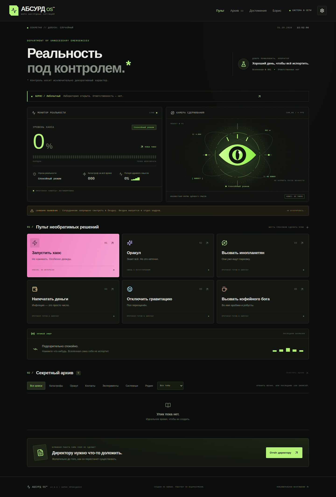
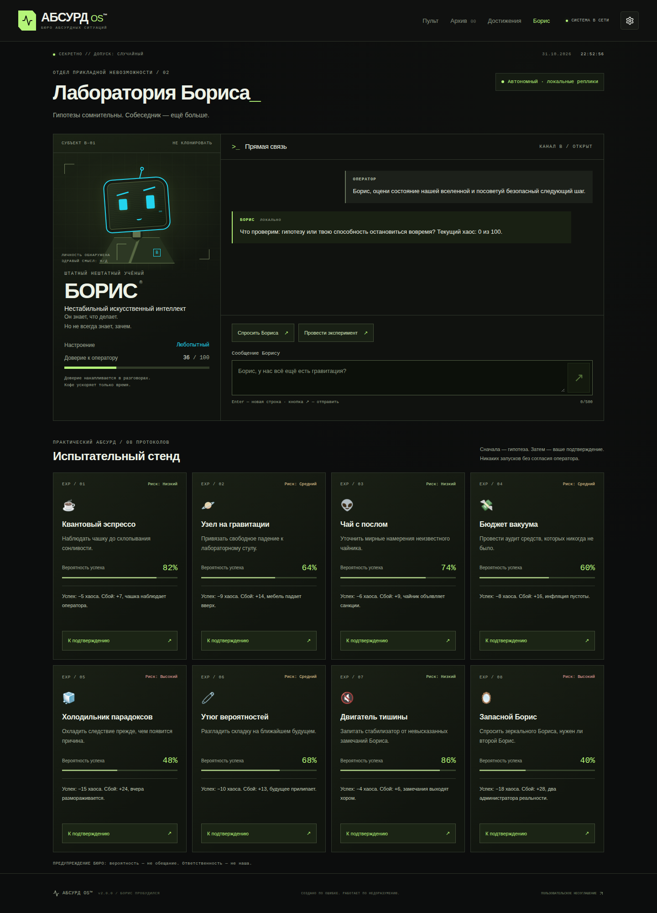
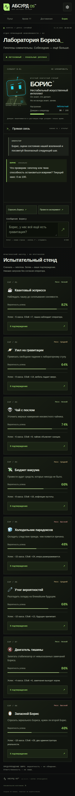
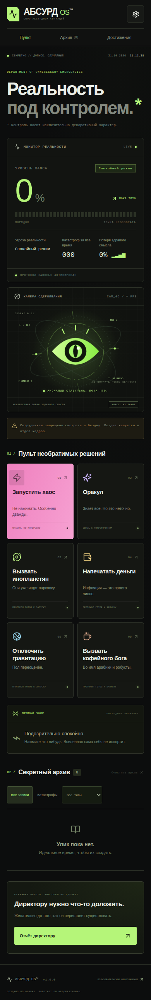

# АБСУРД OS™ V2 — Пробуждение Бориса

**БЮРО АБСУРДНЫХ СИТУАЦИЙ**
DEPARTMENT OF UNNECESSARY EMERGENCIES

Секретная операционная система, управляющая нелепыми событиями вселенной. Контроль носит исключительно декоративный характер.

Приложение: https://zhorik333.github.io/absurd-os/
Репозиторий: https://github.com/Zhorik333/absurd-os

## Что нового в V2

- Отдельная лаборатория Бориса (`#boris`): оригинальный анимированный аватар, восемь настроений, доверие, чат и контекстные автономные ответы без API.
- Восемь экспериментов с вероятностью успеха, риском, подтверждением, уникальными анимациями и редкими последствиями. Результаты проходят через движок и сохраняются в архиве.
- Реактивная камера: от спокойного глаза до потери сдерживания; Борис вмешивается в финале.
- Семь открытых и три скрытых достижения V2, дополнительно к восьми достижениям V1. Скрытые названия/условия не раскрываются до получения.
- Редкие самостоятельные происшествия, подробные дела событий, фильтры источников и опасности.
- Девять синтезированных звуковых каналов, громкость и отдельные переключатели. Звук по умолчанию выключен.
- Необязательный защищённый AI-сервер на Cloudflare Workers. По умолчанию выключен; настоящий провайдер не настроен и не объявляется работающим. Инструкция: [docs/AI-SETUP.md](docs/AI-SETUP.md).
- Миграция старых сохранений без смены ключа. Перед первой миграцией делается best-effort копия V1 в `absurd-os:backup:v1`; чат и расширенные поля V2 валидируются и сохраняются отдельно от неизменного ядра V1.

## Сохранённые функции V1

- 60 оригинальных катастроф, 50 предсказаний и по 8 событий контакта с инопланетянами, экономики, гравитации и кофейного культа — 142 авторских миниатюры без API и шаблонного склеивания фраз.
- Шесть интерактивных протоколов. Кофейный бог способен уменьшать хаос; оракул не повышает его. Катастрофы и остальные опасные протоколы повышают хаос.
- Шесть уровней состояния: 0–20, 21–40, 41–60, 61–80, 81–99, 100%. В финале — специальная сцена и перезапуск вселенной.
- Живая камера аномалии: оригинальная SVG-иллюстрация, орбиты, глаз, телеметрия. Разные анимации событий, невесомость, управляемые визуальные сбои.
- Архив последних 150 событий с фильтрацией, датой, временем, типом, описанием и изменением хаоса; очистка требует подтверждения.
- Восемь достижений, три скрытые механики. Спойлеров здесь нет.
- Отчёт директору с диагнозом и копированием. Если Clipboard API недоступен, текст можно выделить и скопировать вручную.
- Web Audio-синтезатор: звук действий, тревоги и конца вселенной. По умолчанию выключен.
- Настройки эффектов, поддержка `prefers-reduced-motion`, клавиатуры и модальных диалогов.
- PWA: установка, локальный precache, автономный запуск и обновление по согласию пользователя.

## Скриншоты





<details><summary>Лаборатория на телефоне</summary>



</details>

<details><summary>Мобильная версия</summary>



</details>

## Технологии

React 19, Vite 6, JavaScript ES Modules, обычный CSS, Lucide React, LocalStorage, Web Audio API. PWA создаётся через `vite-plugin-pwa` и Workbox. Тесты: Node Test Runner и Playwright Chromium.

Для основных функций не нужны backend, аккаунты, аналитика, внешние шрифты, API-ключи или платные сервисы. Все игровые данные и локальный Борис включены в сборку. Дополнительный AI-сервер опционален: секрет хранится только в Cloudflare, а не в браузере или репозитории. Провайдер может быть платным; на сервере есть лимиты запросов и токенов, но отдельный денежный лимит следует выставить в кабинете провайдера.

## Локальный запуск

Нужен Node.js 22. В Windows используйте PowerShell:

```powershell
cd D:\Projects\absurd-os
npm install
npm run dev
```

В WSL:

```bash
cd /mnt/d/Projects/absurd-os
npm ci
npm run dev
```

Откройте адрес, который напечатает Vite, с путём `/absurd-os/`, обычно `http://localhost:5173/absurd-os/`. `localhost` используется только для разработки, а не в production-ресурсах.

Production:

```bash
npm run build
npm run preview
```

Просмотр обычно доступен по `http://localhost:4173/absurd-os/`. Не открывайте `dist/index.html` через `file://`: модулям и Service Worker нужен HTTP/HTTPS. Локальная версия независима от GitHub, но первоначальная установка npm-зависимостей требует интернета.

## Структура

```text
src/main.jsx                интерфейс, маршрутизация hash и диалоги
src/BorisLab.jsx             отдельная лаборатория и аватар
src/world.js                миграция V1/V2, эксперименты и достижения
src/boris.js                 автономные ответы, контекст и история
src/boris-content.js         авторские реплики
src/experiments.js           каталог и белый список команд
src/Anomaly.jsx              оригинальный глаз с реакцией на хаос
src/audio.js                Web Audio и звуковые каналы
src/ai-client.js             ограниченные запросы и безопасный fallback
worker/                     необязательный Cloudflare Worker и лимитер
src/style.css               адаптивная панель и анимации
src/event-effects.css       эффекты протоколов и мобильная навигация
src/tokens.css              дизайн-токены
src/engine.js               чистый движок, валидация, сохранение, отчёты
src/content.js              оригинальные события и предсказания
src/pwa.js                  регистрация SW, установка и обновление
public/icons/               собственные PNG-иконки 180/192/512, maskable
public/favicon.svg          исходный векторный символ
public/offline.html         автономная резервная страница
scripts/                    проверки PWA и обновления SW
tests/                      модульные и браузерные тесты
docs/                       реальные скриншоты
.github/workflows/deploy.yml CI и публикация Pages
```

Manifest и Service Worker генерируются в `dist/manifest.webmanifest` и `dist/sw.js`. Параметры manifest находятся в `vite.config.js`; SW вручную редактировать не нужно.

## GitHub и публикация

Репозиторий публичный, основная ветка `main`. Workflow при каждом push выполняет установку зависимостей, модульные тесты, сборку и production-браузерные тесты, затем отправляет `dist` в GitHub Pages.

Для своей копии:

1. Создайте публичный репозиторий на GitHub либо выполните:

   ```bash
   git init -b main
   git add .
   git commit -m "Create Absurd OS"
   gh repo create absurd-os --public --source=. --remote=origin --push
   ```

   Для уже инициализированной копии не повторяйте `git init` и не перезаписывайте существующий origin.

2. В Settings → Pages → Build and deployment выберите **GitHub Actions**. Через CLI можно включить Pages API:

   ```bash
   gh api --method POST repos/USERNAME/absurd-os/pages -f build_type=workflow
   ```

   Если Pages уже включён, используйте `PUT` вместо `POST`.

3. Откройте вкладку Actions и дождитесь зелёных build/deploy.
4. Проверьте реальный адрес `https://USERNAME.github.io/REPOSITORY/`.

Vite автоматически получает имя репозитория из `GITHUB_REPOSITORY` в Actions. Без переменных используется `/absurd-os/`. Для другого хостинга можно явно задать base:

```bash
VITE_BASE_PATH=/ npm run build
# или
VITE_BASE_PATH=/other-repository/ npm run build
```

В PowerShell перед сборкой используйте `$env:VITE_BASE_PATH = '/other-repository/'`. Manifest, start_url, scope, скрипты, CSS и precache используют этот base. Не добавляйте GitHub-токены в проект. Для подключения репозитория без `gh` допустимы обычный git и существующая системная авторизация.

## Обновление приложения

```bash
git pull --ff-only
# Внесите изменения
npm ci
npm test
npm run build
git add .
git commit -m "Update Absurd OS"
git push origin main
```

Actions публикует новую сборку. При обнаружении новой версии появляется предложение «Обновить систему». Обновление не должно принудительно перезагружать игру; пользователь подтверждает его сам. Прогресс хранится отдельно от кэша и переживает замену версии.

## PWA и автономная работа

После первого успешного online-посещения Service Worker устанавливает precache: HTML, JS, CSS, manifest, иконки и offline-страницу. Обычная навигация без сети получает **полноценное приложение**, а не только заглушку. После установки кэша все основные игровые механики, диалог с локальным Борисом и эксперименты работают без сети. AI при отсутствии сети или ошибке возвращается к автономному Борису с явным уведомлением.

`offline.html` — дополнительная автономная страница по `/absurd-os/offline.html`; для стандартного запуска SW отдаёт закэшированный `index.html`. Не закрывайте первое посещение до окончания загрузки. Первый визит без интернета не может работать: файлов ещё нет на устройстве. Браузер может удалить кэш при нехватке места; тогда один раз откройте приложение online заново.

### Android / компьютер

Настройки → «📲 УСТАНОВИТЬ АБСУРД OS™». При наличии `beforeinstallprompt` открывается нативный запрос. Если браузер не предоставляет событие, показывается инструкция по меню браузера. Chrome/Edge обычно поддерживают установку; наличие команды зависит от браузера и платформы.

### iPhone / iPad

Откройте сайт в Safari → «Поделиться» → «На экран Домой» → «Добавить». Установленная копия запускается в standalone-режиме. В этом режиме кнопка установки заменена статусом «ПРИЛОЖЕНИЕ УСТАНОВЛЕНО». Встроенные браузеры мессенджеров могут не поддерживать установку — сначала откройте Safari.

Нельзя обещать один механизм установки во всех браузерах. Реальная установка с иконки на физических iPhone/Android требует проверки на этих устройствах; автоматические тесты проверяют manifest, Chromium installability, логику install prompt/standalone, precache, offline reload и реальный цикл замены SW, но не заменяют ручной телефонный тест.

## LocalStorage и конфиденциальность

AI выключен по умолчанию. В настройках можно явно включить его и указать публичный HTTPS-адрес Worker, заканчивающийся `/boris`. Только после такого согласия сообщение и ограниченный контекст отправляются вашему серверу и его AI-провайдеру. Не отправляйте личную информацию; не вводите API-ключ вместо адреса. Выключение AI возвращает полностью локальный режим.

Ключ: `absurd-os:universe:v1` (сохранён для совместимости, внутри `schemaVersion: 2`). Дополнительно сохраняются до 80 сообщений, настроение/доверие Бориса, статистика экспериментов и достижения V2. Сохраняются хаос, архив, суммарные катастрофы, номер вселенной, настройки, достижения, секреты и короткая последовательность действий. Потеря здравого смысла вычисляется из сохранённых показателей.

- Сохраняем только последние 150 записей. Интерфейс показывает историю порциями.
- Новая вселенная обнуляет хаос и последовательность действий, но сохраняет архив, суммарный счётчик, достижения и допуски.
- Очистка архива удаляет только записи, не весь прогресс.
- Повреждённый JSON восстанавливается безопасными значениями. Вложенные поля проверяются по белому списку, числа ограничены, неизвестные достижения/типы отбрасываются.
- Если хранилище заблокировано или переполнено, интерфейс предупреждает, а игра продолжает работать в памяти.
- Очистка **данных сайта** удаляет прогресс; очистка только **CacheStorage** не удаляет LocalStorage.
- Разные браузеры/домены и некоторые установленные копии iOS могут иметь раздельное хранилище. Синхронизации между устройствами нет.

## Проверки

```bash
npm test
node --test scripts/pwa.test.mjs
npm run build
node scripts/check-pwa-build.mjs
npx playwright install chromium
PWA_TEST=1 npm run test:e2e -- --workers=1
node scripts/check-sw-update.mjs
```

Последние две команды запускаются после production build. В PowerShell: `$env:PWA_TEST = '1'`, затем `npm run test:e2e -- --workers=1`. Завершите ранее запущенный dev-сервер на тестовом порту 4173. `APP_URL` позволяет тестировать уже работающий preview/public URL; PWA-тест ожидает базу `/absurd-os/`.

Проверяются содержание 142 записей, границы хаоса, история, уникальность идентификаторов, все достижения и секретные условия, защита хранилища, кнопки, сохранение после reload, отчёт и Clipboard, финал и перезапуск, ширины 320–1440, reduced motion, отсутствие JS-ошибок, manifest/installability, автономный запуск и восстановление кэша. `check-sw-update.mjs` поднимает локальный тестовый HTTP-сервер с двумя версиями SW и проверяет реальное ожидание обновления/согласие/сохранность прогресса.

`npm audit --omit=dev` проверяет зависимости, поставляемые пользователю. Транзитивные замечания аудита инструментов сборки отслеживаются отдельно; не применяйте принудительные несовместимые обновления без повторной сборки и PWA-тестов.

## Лицензия

MIT. Исходные тексты, иллюстрации и иконки проекта созданы для АБСУРД OS™. Иконки Lucide распространяются под ISC.
